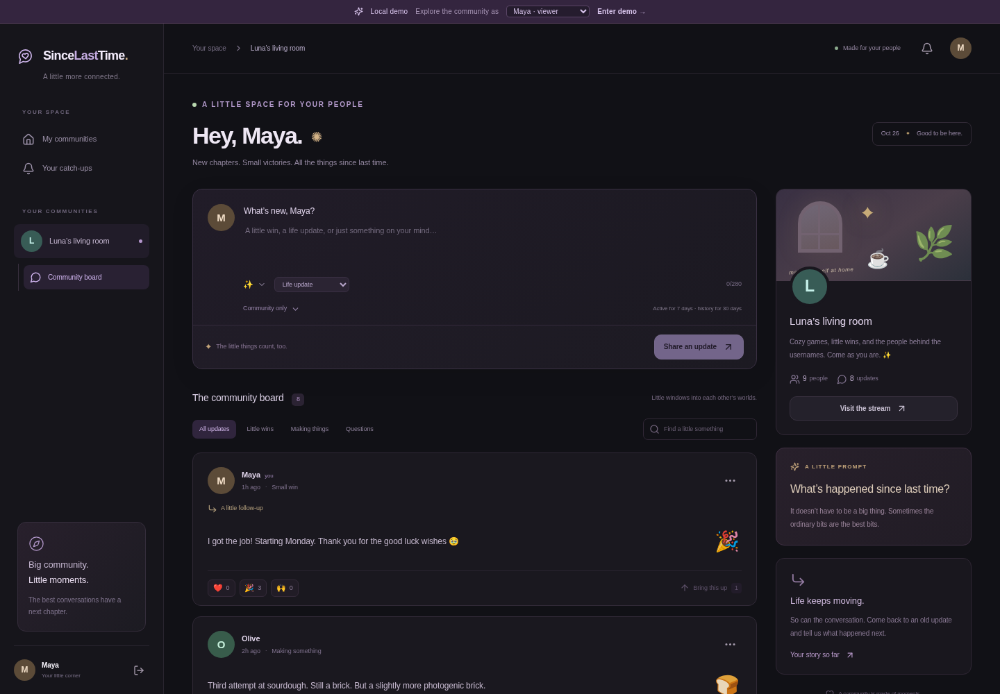
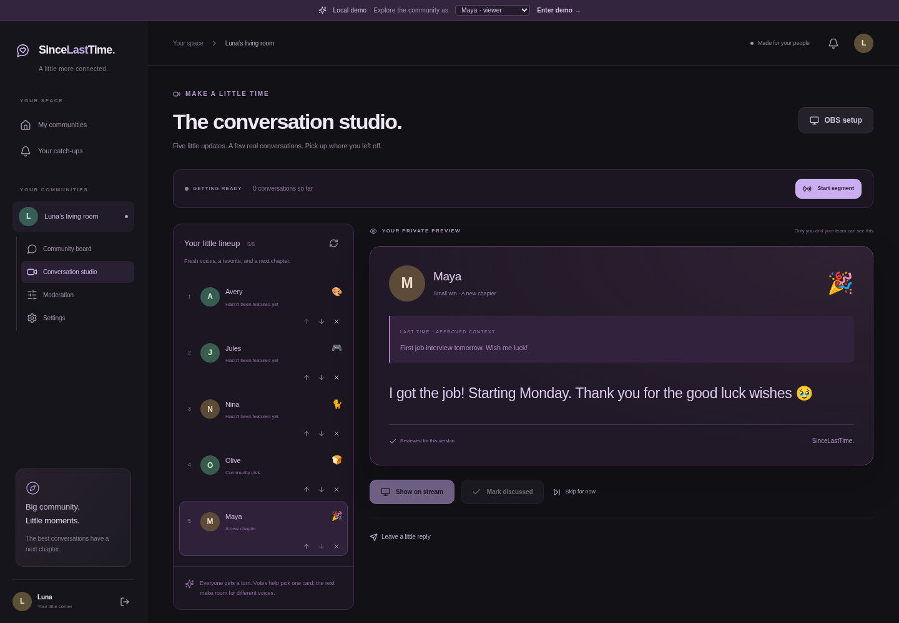

# SinceLastTime

**Your community remembers what’s happening in your life.**

A Twitch-connected community board, conversation studio, and OBS overlay. Viewers share short updates inside a streamer’s community, the streamer makes time to catch up, and a later update picks up the story where it left off.

Built for the Codex × TwitchCon Hackathon.



## What’s included

- Twitch OAuth sign-in and verified-follower community membership.
- One current status per person per community, with text, emoji, categories, reactions, and community nominations.
- Community profiles and linked story updates.
- A persisted conversation lineup: fair rotation, a community favorite, and a follow-up.
- Streamer review, replies, discussion acknowledgements, and a read-only OBS browser-source overlay.
- Explicit public-broadcast permission, version-specific approval, and server-side consent invalidation.
- Optional in-app follow-up invitations and a background worker.
- Board moderators, reports, hidden-post review, membership controls, and owner settings.
- Mobile layouts, development demo identities, automated tests, Docker packaging, and CI.

Profiles live in this application. SinceLastTime does not add fields to Twitch’s native profile cards.

## Run the local demo

Requirements: **Node.js 22 LTS (22.12 or newer)**, npm, and PostgreSQL 17. Docker Compose is the easiest way to start the database.

```bash
git clone https://github.com/HaggardHarsh/SinceLastTime.git
cd SinceLastTime
npm ci
cp .env.example .env
```

Set `DEMO_MODE=true` in `.env`. The sample database URL matches the development Compose configuration. Generate a token encryption key with `openssl rand -base64 32` and put it in `TOKEN_ENCRYPTION_KEY` before connecting real Twitch accounts.

```bash
docker compose up -d db
npm run db:generate
npm run db:migrate
npm run db:seed
npm run dev
```

Open `http://localhost:3000`. The local demo bar switches between Maya (viewer), Luna (streamer), Rohan (moderator), Olive (viewer), and a non-follower. The seeded board is `/c/luna`.

Run the worker in a second terminal:

```bash
npm run worker
```

The demo seed is idempotent and refuses to run in production. Demo identities are available only when `DEMO_MODE=true` outside production. Production startup rejects demo mode.

## Connect real Twitch accounts

1. Create a confidential application in the [Twitch developer console](https://dev.twitch.tv/console/apps).
2. Register `http://localhost:3000/api/auth/twitch/callback` as the local OAuth redirect URL.
3. Set `TWITCH_CLIENT_ID`, `TWITCH_CLIENT_SECRET`, and a generated `TOKEN_ENCRYPTION_KEY` in `.env`.
4. Set `DEMO_MODE=false` and restart the web application and worker.
5. Sign in as the streamer and create their community from **My communities**.
6. Use another browser profile for a follower. Open `/c/<streamer-login>` and join.

The requested scope is `user:read:follows`. The application verifies a viewer’s follow using the viewer’s own authorization and a broadcaster-filtered Twitch API call. Successful checks are cached for up to five minutes. Local suspensions apply immediately.

Production needs its own HTTPS callback URL matching `APP_BASE_URL`. See [deployment instructions](docs/DEPLOYMENT.md).

## Use the conversation studio

1. Viewers grant broadcast permission on the updates they want considered.
2. The streamer or board moderators prepare a conversation segment.
3. Review, reorder, or replace cards before starting. A short explanation accompanies each suggestion.
4. The streamer opens **OBS setup**, generates a link, and adds it as a 1920 × 1080 Browser Source in OBS.
5. Start the segment, approve the exact card version, and select **Show on stream**.
6. After the conversation, select **Mark discussed**. This updates fairness history exactly once.
7. If the viewer welcomed a follow-up, optionally schedule an in-app invitation.

Showing a card, skipping a card, and completing a conversation are separate actions. The overlay clears after ending the segment, deleting or hiding a selected update, withdrawing consent, or losing a fresh server response.



## Content lifecycle

| Behavior             | Default                                                             |
| -------------------- | ------------------------------------------------------------------- |
| Board access         | Twitch sign-in, verified follow, explicit join                      |
| Community scope      | Separate statuses and profiles for each streamer                    |
| Active status        | Seven days, one current entry per member                            |
| Story history        | Thirty days from each entry’s creation                              |
| Broadcast permission | Off until the author opts in                                        |
| Follow-up reminders  | Off until the author opts in; one per source entry                  |
| Nomination weight    | One vote per member; never weighted by payment                      |
| Follower check cache | At most five minutes                                                |
| Overlay polling      | One second; hides after three seconds without a successful response |

Content expires on reads even if maintenance is delayed. The worker purges old text and associated responses. Minimal IDs and discussion counters remain for fairness and auditing. Deleting a card cannot alter video recordings already made elsewhere.

## Commands

| Command                    | Purpose                                                       |
| -------------------------- | ------------------------------------------------------------- |
| `npm run dev`              | Development server with webpack                               |
| `npm run build`            | Generate Prisma client and compile production application     |
| `npm start`                | Validate production settings and start the production server  |
| `npm run worker`           | Run OAuth validation, reminders, and retention maintenance    |
| `npm run worker -- --once` | Run one maintenance pass                                      |
| `npm run db:generate`      | Generate the Prisma client                                    |
| `npm run db:migrate`       | Apply committed migrations                                    |
| `npm run db:seed`          | Load local-only demo fixtures                                 |
| `npm run check`            | Type checking and unit tests                                  |
| `npm run test:integration` | Real HTTP/PostgreSQL workflow tests; requires the demo server |
| `npm run test:e2e`         | Chromium acceptance tests; starts or reuses the demo server   |

## Verification

```bash
npm run check
# With the local demo server running:
npm run test:integration
npx playwright install chromium
npm run test:e2e
npm run build
```

The suite includes 31 unit checks, four HTTP/PostgreSQL workflow scenarios, and five browser scenarios. Browser tests cover desktop/mobile interactions, literal rendering of submitted markup, linked updates, streamer review, actual overlay-page presentation, and non-follower denial.

Integration tests create temporary demo users and communities and remove them afterward. Use a development/test database. CI runs against its own PostgreSQL service.

Live Twitch OAuth and a physical OBS installation require your Twitch application credentials and an external manual check. The Twitch adapter is covered using mocked service responses; the database, app routes, and browser flows are exercised directly.

## Implementation notes

- Next.js App Router, React, TypeScript, Tailwind CSS, and TanStack Query.
- PostgreSQL with Prisma and the PostgreSQL driver adapter.
- Server-side Twitch authorization-code flow, encrypted provider tokens, and hashed opaque sessions.
- Database-backed authorization, rate limits, discussion idempotency, and worker deduplication.
- A single codebase with separate web and worker processes.

The SQL migration includes composite ownership constraints and a partial unique index for active segments. Preserve those safeguards when extending the schema.

More detail: [architecture](docs/ARCHITECTURE.md), [deployment](docs/DEPLOYMENT.md), [demo walkthrough](docs/DEMO.md), and [implementation milestones](BUILD.md).
