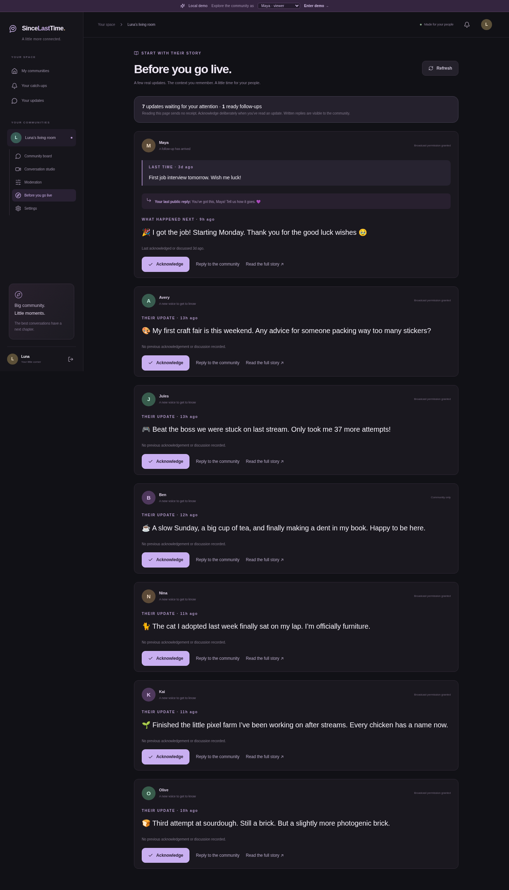

# SinceLastTime

**Your community remembers what’s happening in your life.**

A Twitch-connected community board, conversation studio, and OBS overlay. Viewers share short updates inside a streamer’s community, the streamer makes time to catch up, and a later update picks up the story where it left off.

Built for the Codex × TwitchCon Hackathon.


## What’s included

- Twitch OAuth sign-in and verified-follower community membership.
- One current status per person per community, with text, emoji, categories, reactions, and community nominations.
- Community profiles and linked story updates.
- Private, deliberate streamer acknowledgements and community-visible replies.
- An owner-only pre-stream briefing with actual story excerpts and previous responses.
- A persisted conversation lineup: fair rotation, a community favorite, and a follow-up.
- Streamer review, replies, discussion acknowledgements, and a read-only OBS browser-source overlay.
- Explicit public-broadcast permission, version-specific approval, and server-side consent invalidation.
- Optional in-app follow-up invitations and a background worker.
- Off-stream follow-ups for acknowledged community-only updates.
- Author controls for hidden posts and communities a person has left or been suspended from.
- A streamer setup checklist, downloadable Twitch panel, community link, and chat-command text.
- Board moderators, reports, hidden-post review, membership controls, and owner settings.
- Mobile layouts, development demo identities, automated tests, Docker packaging, and CI.

Profiles live in this application. SinceLastTime does not add fields to Twitch’s native profile cards.

## Run the local demo

Requirements: **Node.js 22 LTS (22.12 or newer)**, npm, and PostgreSQL 17. Docker Compose is the easiest way to start the database; Podman Compose is also supported.

```bash
git clone https://github.com/HaggardHarsh/SinceLastTime.git
cd SinceLastTime
npm ci
cp .env.example .env
```

Set `DEMO_MODE=true` in `.env`. The sample database URL matches the development Compose configuration. Generate a token encryption key with `openssl rand -base64 32` and put it in `TOKEN_ENCRYPTION_KEY` before connecting real Twitch accounts.

Start PostgreSQL with one of these commands:

```bash
# Docker: start Docker Desktop or the Docker daemon first.
docker compose up -d db

# Podman: use this if Docker is not running on your machine.
podman compose up -d db
```

Then initialize and run the application:

```bash
npm run db:generate
npm run db:migrate
npm run db:seed
npm run dev
```

Open `http://localhost:3000`. `GET` lines in the terminal show that the development server is running; `GET /api/me 401` is expected before signing in. On the sign-in screen, choose **Try viewer demo** or **Try streamer demo**; no Twitch credentials are needed for these sample identities. The local demo bar switches between Maya (viewer), Luna (streamer), Rohan (moderator), Olive (viewer), and a non-follower. The seeded board is `/c/luna`.

If you keep two local checkouts, they cannot both use the default database port (`5432`) or development port (`3000`). Stop the other checkout first, or give one checkout a different PostgreSQL port and `DATABASE_URL` before starting it.

Run the worker in a second terminal:

```bash
npm run worker
```

The demo seed is idempotent and refuses to run in production. Demo identities are available only when `DEMO_MODE=true` outside production. Production startup rejects demo mode.

## Connect real Twitch accounts

1. Create a confidential application in the [Twitch developer console](https://dev.twitch.tv/console/apps).
2. Register `http://localhost:3000/api/auth/twitch/callback` as the local OAuth redirect URL.
3. Set `TWITCH_CLIENT_ID`, `TWITCH_CLIENT_SECRET`, and a generated `TOKEN_ENCRYPTION_KEY` in `.env`.
4. Set `DEMO_MODE=false` and restart the web application and worker.
5. Sign in as the streamer and create their community from **My communities**.
6. Use another browser profile for a follower. Open `/c/<streamer-login>` and join.

The requested scope is `user:read:follows`. The application verifies a viewer’s follow using the viewer’s own authorization and a broadcaster-filtered Twitch API call. Successful checks are cached for up to five minutes. Local suspensions apply immediately.

Production needs its own HTTPS callback URL matching `APP_BASE_URL`. See [deployment instructions](docs/DEPLOYMENT.md).

## Use the conversation studio

1. Viewers grant broadcast permission on the updates they want considered.
2. The streamer or board moderators prepare a conversation segment.
3. Review, reorder, or replace cards before starting. A short explanation accompanies each suggestion.
4. The streamer opens **OBS setup**, generates a link, and adds it as a 1920 × 1080 Browser Source in OBS.
5. Start the segment, approve the exact card version, and select **Show on stream**.
6. After the conversation, select **Mark discussed**. This updates fairness history exactly once.
7. If the viewer welcomed a follow-up, optionally schedule an in-app invitation. A private acknowledgement can also enable an invitation without a broadcast.

Showing a card, skipping a card, and completing a conversation are separate actions. The overlay clears after ending the segment, deleting or hiding a selected update, withdrawing consent, or losing a fresh server response.


## Make time without a broadcast

Open **Before you go live** at `/c/<streamer-login>/briefing`. The streamer sees current updates needing attention, their previous chapter, the last public reply, and ready follow-ups. The briefing includes community-only posts and uses actual text, not generated summaries.

Choose **Acknowledge** deliberately. Only the author and streamer see the receipt; opening an update sends nothing. **Reply to the community** writes a community-visible response and also acknowledges the update. An opted-in viewer can receive one follow-up invitation after either acknowledgement or discussion. These actions do not consume an on-stream fairness turn.

Content edits require a fresh acknowledgement. Permission-only changes preserve the receipt. Retention, deletion, moderation, and author membership are checked again when taking an action.



## Invite your community

New streamers land at `/c/<streamer-login>/setup`. Review the welcome and prompt, copy the canonical community link, download the Twitch panel, and copy `!since` command text into your existing chatbot. The checklist saves manual confirmations and automatically detects joined members. OBS setup is optional.

The panel and command send followers to the website. The embedded Twitch Extension remains a future addition. Keep the private OBS link separate from these public sharing tools.

## Manage your own words

Open **Your updates** from the sidebar or account menu. This page lets signed-in authors delete retained posts and withdraw broadcast or follow-up permission, including hidden posts and posts in communities they can no longer access. It does not restore board membership. Full account export/deletion is outside this release.

## Content lifecycle

| Behavior             | Default                                                             |
| -------------------- | ------------------------------------------------------------------- |
| Board access         | Twitch sign-in, verified follow, explicit join                      |
| Community scope      | Separate statuses and profiles for each streamer                    |
| Active status        | Seven days, one current entry per member                            |
| Story history        | Thirty days from each entry’s creation                              |
| Broadcast permission | Off until the author opts in                                        |
| Follow-up reminders  | Opt-in; one per source entry after acknowledgement or discussion    |
| Nomination weight    | One vote per member; never weighted by payment                      |
| Follower check cache | At most five minutes                                                |
| Overlay polling      | One second; hides after three seconds without a successful response |

Content expires on reads even if maintenance is delayed. The worker purges old text and associated responses. Minimal IDs and discussion counters remain for fairness and auditing. Deleting a card cannot alter video recordings already made elsewhere.

## Commands

| Command                    | Purpose                                                       |
| -------------------------- | ------------------------------------------------------------- |
| `npm run dev`              | Development server with webpack                               |
| `npm run build`            | Generate Prisma client and compile production application     |
| `npm start`                | Validate production settings and start the production server  |
| `npm run worker`           | Run OAuth validation, reminders, and retention maintenance    |
| `npm run worker -- --once` | Run one maintenance pass                                      |
| `npm run db:generate`      | Generate the Prisma client                                    |
| `npm run db:migrate`       | Apply committed migrations                                    |
| `npm run db:seed`          | Load local-only demo fixtures                                 |
| `npm run assets:panel`     | Rebuild the panel PNG from its vector source; needs Chromium  |
| `npm run check`            | Type checking and unit tests                                  |
| `npm run test:integration` | Real HTTP/PostgreSQL workflow tests; requires the demo server |
| `npm run test:e2e`         | Chromium acceptance tests; starts or reuses the demo server   |

## Verification

```bash
npm run check
# With the local demo server running:
npm run test:integration
npx playwright install chromium
npm run test:e2e
npm run build
```

The suite includes 36 unit checks, twenty HTTP/PostgreSQL scenarios, and ten browser scenarios. Coverage includes controlled concurrent requests, author controls after suspension, private/version-specific receipts, community-only follow-ups, exact briefing context, search and selection beyond earlier limits, Twitch panel downloads, mobile logout, and actual overlay-page presentation. Integration files run serially because worker scenarios intentionally exercise database-wide maintenance.

Integration tests create temporary demo users and communities and remove them afterward. Use a development/test database. CI runs against its own PostgreSQL service.

Live Twitch OAuth and a physical OBS installation require your Twitch application credentials and an external manual check. The Twitch adapter is covered using mocked service responses; the database, app routes, and browser flows are exercised directly.

## Implementation notes

- Next.js App Router, React, TypeScript, Tailwind CSS, and TanStack Query.
- PostgreSQL with Prisma and the PostgreSQL driver adapter.
- Server-side Twitch authorization-code flow, encrypted provider tokens, and hashed opaque sessions.
- Database-backed authorization, rate limits, discussion idempotency, and worker deduplication.
- A single codebase with separate web and worker processes.

The SQL migrations include composite ownership constraints, a partial unique index for active segments, and a partial retention-backlog index. Preserve those safeguards when extending the schema. The 0.2 release uses additive migrations and requires matching web and worker versions; see the [upgrade notes](docs/UPGRADE_0_2.md).

More detail: [architecture](docs/ARCHITECTURE.md), [deployment](docs/DEPLOYMENT.md), [demo walkthrough](docs/DEMO.md), and [implementation milestones](BUILD.md).
