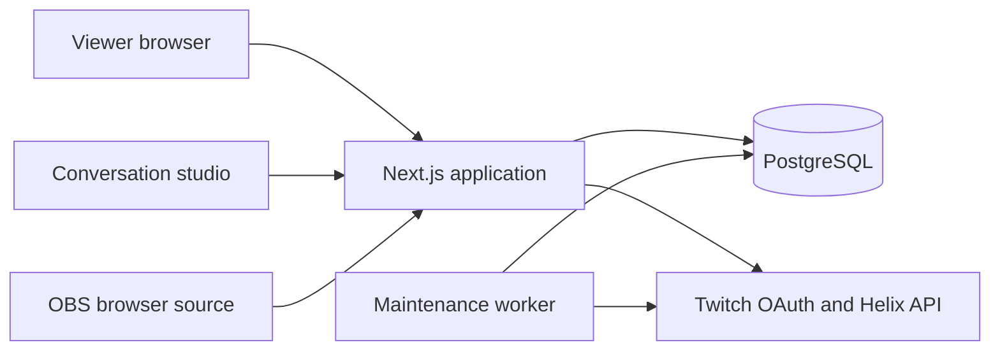

# Architecture

## Processes and data flow

The Next.js application serves the website and JSON API. A separate TypeScript worker shares the PostgreSQL database. Browser polling keeps the first release simple: ten seconds for board activity, two seconds for studio state, and one second for the OBS overlay.

## Code organization

- `src/app`: route entry points, metadata, and shared styling.
- `src/components`: interactive screens, shared controls, and query providers.
- `src/server`: authentication, authorization, lifecycle services, ranking, and API routing.
- `src/shared`: browser-safe DTOs and fixed option lists.
- `prisma`: model, migration, ownership constraints, and active-segment index.
- `scripts`: fixtures, production checks, worker entry point, and CI readiness wait.

All API operations enter through the catch-all Route Handler and server router. Mutations verify origin and JSON content type. Community services authorize the current identity and membership before reading protected data.

## Identity and community boundaries

Twitch OAuth establishes the immutable Twitch ID. Provider access and refresh tokens are encrypted with AES-256-GCM. The browser receives an opaque HTTP-only session cookie; only its SHA-256 hash is stored in the database.

Followers explicitly join each board. The viewer’s `user:read:follows` grant verifies that specific broadcaster. Successful checks last at most five minutes. Verification outages do not grant access once that proof is stale. A suspended membership cannot be restored by a delayed follow-check or join request.

Board moderators are appointed application roles. They do not automatically gain or grant permissions on Twitch. Only the streamer controls live presentation, writes streamer replies, or schedules follow-ups.

## Status and story model

A membership points to one current status entry. Each entry belongs to a story, author, and community. Composite database constraints prevent a membership’s current pointer or a story link from crossing authors or communities.

New chapters append to the same story, become current, and receive their own consent flags and seven-day lifetime. Previous chapters remain readable within thirty-day retention. Content edits invalidate votes, reactions, broadcast approval, and any presentation that references the entry. Consent changes invalidate presentation without rewriting the author’s text.

## Conversation selection

Reserve a ready follow-up first, then a voted community favorite from another author. Fill the remaining slots with fair rotation, yielding three rotation slots when both special slots exist. Missing special slots become additional rotation slots.

Fair rotation prioritizes never-discussed members, longest waiting members, lifetime discussion count, then oldest entry and stable ID. A completed discussion is unique per segment/author. Preview and display do not increment fairness history.

Prepared queues persist in PostgreSQL and survive refreshes. The database permits one draft/live segment per community.

## Broadcast boundary

Approval is tied to an exact entry version. Every display operation and overlay response checks current content, author membership, visibility, retention, permission, review, and unresolved reports.

The OBS token grants read-only access to one selected presentation, not the community API or queue. It is stored as a hash and passed in the overlay URL fragment, then in an Authorization header. Rotating it invalidates the prior link.

Older context appears only when independently approved and still permitted. The overlay hides after three seconds without a fresh successful response.

## Worker and operational behavior

The worker validates maintained Twitch sessions at startup and before the hourly validation boundary. Refreshes are serialized per account and replace both tokens atomically. Revoked sessions are ended.

Maintenance uses a PostgreSQL advisory lock and notification deduplication keys. It delivers due invitations, purges old content, removes expired state/rate buckets, and updates a heartbeat. Its default loop runs once a minute; correctness on reads does not depend on that timing.

`/api/health` checks process availability. `/api/readiness` checks the database and, in production, a recent worker heartbeat.
