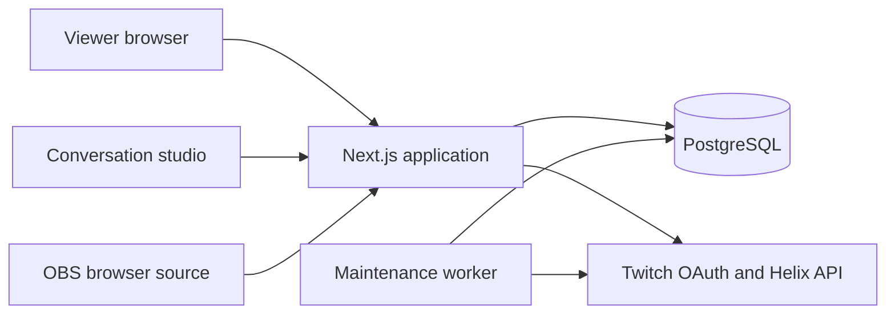

# Architecture

## Processes and data flow

The Next.js application serves the website and JSON API. A separate TypeScript worker shares the PostgreSQL database. Browser polling keeps the first release simple: ten seconds for board activity, two seconds for studio state, and one second for the OBS overlay.

## Code organization

- `src/app`: route entry points, metadata, and shared styling.
- `src/components`: interactive screens, shared controls, and query providers.
- `src/server`: authentication, authorization, lifecycle services, ranking, and API routing.
- `src/shared`: browser-safe DTOs and fixed option lists.
- `prisma`: model, migration, ownership constraints, and active-segment index.
- `scripts`: fixtures, production checks, worker entry point, and CI readiness wait.

All API operations enter through the catch-all Route Handler and server router. Mutations verify origin and JSON content type. Community services authorize the current identity and membership before reading protected data.

## Identity and community boundaries

Twitch OAuth establishes the immutable Twitch ID. Provider access and refresh tokens are encrypted with AES-256-GCM. The browser receives an opaque HTTP-only session cookie; only its SHA-256 hash is stored in the database.

Followers explicitly join each board. The viewer’s `user:read:follows` grant verifies that specific broadcaster. Successful checks last at most five minutes. Verification outages do not grant access once that proof is stale. A suspended membership cannot be restored by a delayed follow-check or join request.

Board moderators are appointed application roles. They do not automatically gain or grant permissions on Twitch. Only the streamer controls live presentation, writes streamer replies, acknowledges updates, or schedules follow-ups. Briefing and acknowledgement history are owner-only; authors can see their own receipts. Account-level author controls authenticate ownership independently of community membership.

## Status and story model

A membership points to one current status entry. Each entry belongs to a story, author, and community. Composite database constraints prevent a membership’s current pointer or a story link from crossing authors or communities.

New chapters append to the same story, become current, and receive their own consent flags and seven-day lifetime. Previous chapters remain readable within thirty-day retention. Content edits invalidate votes, reactions, broadcast approval, pending invitations, the current acknowledgement receipt, and any presentation that references the entry. `contentVersion` changes with actual content; the existing `version` also covers permission and moderation mutations. Consent changes preserve content acknowledgement while invalidating presentation.

Every text projection checks retention. A studio queue preserves an unavailable placeholder after expiration, hiding the entry and its replies before maintenance runs. Acknowledgements store only identity, content version, and time; they do not retain text snapshots.

Mutations use a consistent lock order: segment when applicable, author membership, entry, dependent records, overlay. Edits and discussion completion recheck eligibility after locking. Discussion completion needs the exact version actually shown, separately from approval.

## Conversation selection

Reserve a ready follow-up first, then a voted community favorite from another author. Fill the remaining slots with fair rotation, yielding three rotation slots when both special slots exist. Missing special slots become additional rotation slots.

Fair rotation prioritizes never-discussed members, longest waiting members, lifetime discussion count, then oldest entry and stable ID. A completed discussion is unique per segment/author. Preview and display do not increment fairness history.

Prepared queues persist in PostgreSQL and survive refreshes. The database permits one draft/live segment per community.

Database CTEs rank the entire eligible community; there is no 500-entry cutoff. Only selected cards are hydrated. Candidate browsing is separately paginated and fetched when needed. Feed search runs on the server with literal case-insensitive matching and value-based cursors that survive row deletion.

## Personal attention and briefing

The owner briefing includes community-only current updates and uses exact retained chapters/replies. It orders ready follow-ups first, then members least recently acknowledged or discussed. Opening it has no acknowledgement side effects. An explicit acknowledgement or public reply writes one receipt per entry/content version; the author receives one relevant notification. Acknowledgement never increments broadcast discussion counters.

An opted-in follow-up can start after acknowledgement or discussion. Its source content version, consent, visibility, author state, and retention are revalidated under lock. A linked update becomes ready; acknowledging or discussing the result completes the personal invitation.

## Broadcast boundary

Approval is tied to an exact entry version. Every display operation and overlay response checks current content, author membership, visibility, retention, permission, review, and unresolved reports.

The OBS token grants read-only access to one selected presentation, not the community API or queue. It is stored as a hash and passed in the overlay URL fragment, then in an Authorization header. Rotating it invalidates the prior link.

Older context appears only when independently approved and still permitted. The overlay hides after three seconds without a fresh successful response.

Studio indicators use the same presentation resolver as the overlay. Historical `SHOWN` state is distinct from the currently selected entry. Overlay polling selects minimal author, membership, report, and discussion data instead of loading reactions, votes, or private receipts.

## Worker and operational behavior

The worker validates maintained Twitch sessions at startup and before the hourly validation boundary. Refreshes are serialized per account and replace both tokens atomically. Revoked sessions are ended.

Maintenance and OAuth validation run in independent loops. Content maintenance handles at most 100 due reminders and 100 expired entries per pass, using short per-item transactions and notification deduplication. A partial index supports the oldest-first purge backlog. It records completion with the actual completion time. OAuth validation uses 100-account pages, up to five concurrent verifications, startup validation, bounded retry, and its own progress heartbeat. Each loop waits one minute between passes; delayed external verification does not block cleanup or reminders.

`/api/health` checks process availability. `/api/readiness` checks the database and, in production, recent maintenance and OAuth heartbeats. It reports overdue validation accounts separately. Authentication continues to fail closed when fresh verification is required and unavailable.
